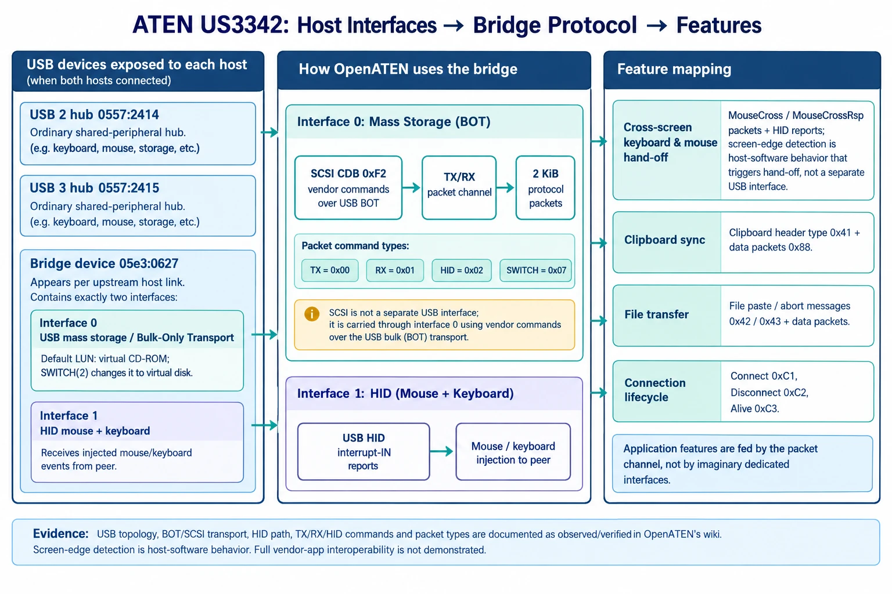

# Host-bridge protocol (as understood so far)

Status legend: **[verified]** observed on real hardware (host-to-host loopback through one switch);
**[inferred]** read from interoperability research but not yet exercised on hardware.

## Topology

The US3342-class switch has two upstream USB-C ports (one per computer). Besides sharing downstream peripherals, a
Genesys Logic controller inside it exposes a **host-to-host bridge** to each upstream computer as a second USB
device (`05e3:0627`, "USB Storage") with two interfaces:

| Interface | Class | Use |
|---|---|---|
| 0 | Mass storage (bulk-only) | Vendor SCSI commands (opcode `0xF2`): data channel, state, control |
| 1 | HID (mouse + keyboard, one interrupt-IN endpoint) | Receives keyboard/mouse reports injected by the other computer |



The bridge only enumerates when **both** upstream ports are connected to a live host. Connecting both ports to the
same computer works as a loopback and is the easiest way to develop.

Each end reports a role in its INQUIRY data: `H` (master) or `S` (slave). **[verified]** The end behind the ATEN hub
was `H` in all our setups.

## Vendor command blocks

Commands are 16-byte SCSI CDBs sent through the standard USB bulk-only transport (CBW / data / CSW).

```
byte 0   0xF2
byte 1   checksum: -(sum of all other bytes) & 0xFF
byte 2   command
byte 3   command argument / tag
bytes 4-7 argument (length big-endian for tx/rx; byte 7 = length for hid/state)
```

| Cmd | Name | Data | Notes |
|---|---|---|---|
| 0x00 | TX | out, N bytes | Send one packet to the peer. N = packet length (BE in bytes 4-7). **[verified]** Completes only after the peer's RX command (including its status block) has completed; see turn rules below. |
| 0x01 | RX | in, N bytes | Receive one packet. Blocks until data arrives; the firmware stalls the pipe after ~5.5 s. **[verified]** |
| 0x02 | HID | out, 5 or 8 bytes | Inject a mouse (5 B) or keyboard (8 B) report; it appears as an interrupt-IN report on the *peer's* HID interface. **[verified]** |
| 0x04 | STATE | in, 1 byte | Link state byte, see below. **[verified: reads; bit meanings inferred]** |
| 0x06 | INIT | none | "Init data transfer". Accepted; no observable effect in our tests. **[verified]** |
| 0x07 | SWITCH | none | Byte 3 = mode (2 in the vendor software). Re-enumerates **both** ends; the storage LUN changes from CD-ROM to "Virtual Storage DEVICE" (disk). **[verified]** Not needed for the loopback data channel. |

The kernel's SCSI layer refuses `0xF2` from unprivileged users, so OpenATEN speaks bulk-only transport directly over
libusb, which only needs read/write access to the USB device node.

### State byte (inferred)

| Bit | Meaning |
|---|---|
| 7 | grant send |
| 4 | data waiting to be received |
| 3 | peer/connected flag |
| 2-0 | mode |

In our experiments the byte read `0x00`/`0x08`/`0x40` and never showed bits 4 or 7, even while transfers worked.

## Packets

All control packets are 2048 bytes, little-endian, zero padded. **[verified round-trip for every type below]**

| Offset | Size | Field |
|---|---|---|
| 0x00 | u32 | total length (0x800) |
| 0x04 | u32 | receive length (0 for control packets) |
| 0x08 | u32 | stream id (0 for control packets) |
| 0x0C | u8 | type |
| 0x0D | u8 | response/status code |
| 0x0E | u8 | flags (bit 0 set on control packets) |
| 0x10 | ... | type-specific payload |

| Type | Name | Payload |
|---|---|---|
| 0xC1 | Connect | +0x10 u32 max transfer, +0x14 u16 = 0x0300, +0x16 u16 = 0x0102, +0x18 u8 flag, +0x19 u8 layout, +0x1A u8 connection type (2) |
| 0xC2 | Disconnect | - |
| 0xC3 | Alive | - |
| 0x50 | MouseCross | +0x10 u16 x, +0x12 u16 y, +0x14 u8 edge |
| 0x51 | MouseCrossRsp | +0x10 u8 status, +0x11 u8 = 1 |
| 0x53 | ChangeOrientation | +0x10 u8 layout, +0x11 u8 flag |
| 0x41 | Clipboard header | +0x10 u64 total length, +0x18 u8 kind **[inferred]** |
| 0x88 | Data chunk | stream payload, larger than 2 KiB allowed **[inferred]** |
| 0x42 / 0x43 | Paste files / abort files | +0x10 u8 flag **[inferred]** |
| 0x85 | Response | +0x0D status, +0x10 u32 acknowledged id **[inferred]** |

## Turn rules (verified)

One end does TX then RX, the other RX then TX; out-of-turn commands are refused until the owed exchange is completed. A receiver must read the status block of its RX immediately.
Details and measurements: [hardware.md](hardware.md#flow-control-strict-turn-taking-verified). Transfers up to 2 MiB per command were verified.

## HID reports

The bridge's HID interface has a report descriptor with **report IDs**, so the injected bytes must include them. **[verified: the kernel emits
the matching input events on the receiving end]**

| Device | Bytes | Layout |
|---|---|---|
| Mouse | 5 | `01  buttons  wheel  dx  dy`: report ID 1, five button bits in the low bits of `buttons`, then **wheel before X/Y**, all signed 8-bit; no horizontal scroll |
| Keyboard | 8 | `02  modifiers  key1 .. key6`: report ID 2, modifier bitmask (LCtrl=1, LShift=2, LAlt=4, LGui=8, RCtrl=0x10, ...), six USB key usages; no reserved byte |

Earlier versions of this document (and of the library) used the generic boot-protocol layout without report IDs; the kernel silently dropped such
reports even though the raw bytes still arrived intact at the interrupt endpoint, so raw-endpoint tests alone are not enough.

## Timing hints (inferred from the vendor software)

A master sends Alive about every 3 s; a slave checks for it about every 8 s and drops the link if it goes missing.
